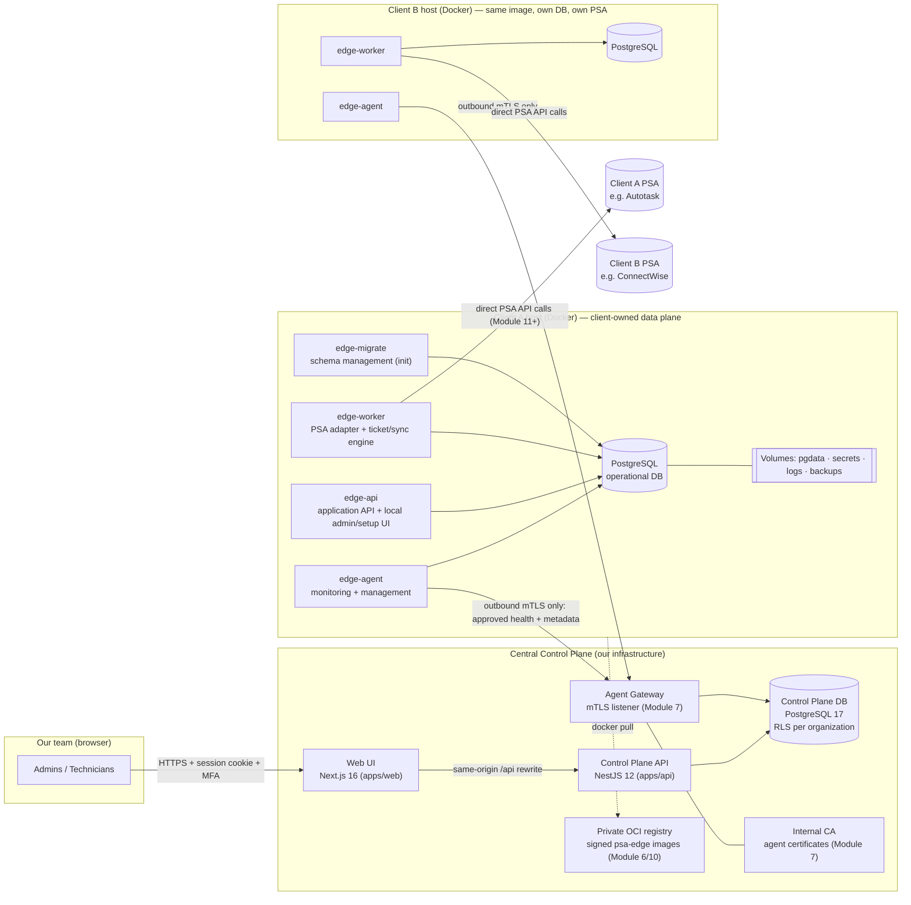
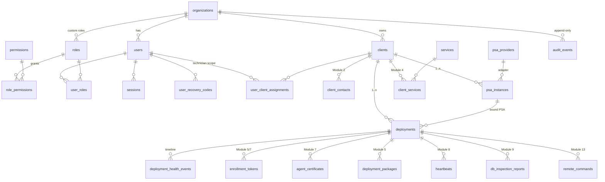

# PSA Control Center — Architecture

Status: **Living document.** Module 1 implements the Control Plane foundation. Sections marked *(Module N)* describe designs that are specified here but implemented later.

Priority order for every trade-off: **Security → Isolation → Reliability → Functionality → Usability → Maintainability → Scalability.**

---

## 1. Architecture overview



### Components

| Component | Tech | Responsibility | Module |
|---|---|---|---|
| **Web UI** (`apps/web`) | Next.js 16 App Router, React 19, Tailwind 4, Recharts, Lucide | Operator UI. Server components fetch from the API with the user's session; client components perform mutations with CSRF tokens. No modal workflows. | 1+ |
| **Control Plane API** (`apps/api`) | NestJS 12 (ESM), `pg`, zod | Users, RBAC, audit, clients, PSA instance *configuration metadata*, services, deployments, packages, health aggregation, DB metadata. Every DB access runs inside a tenant-scoped transaction enforced by PostgreSQL RLS. **Never calls a PSA API** and never stores tickets, attachments or PSA credentials (AD-11). | 1+ |
| **Agent Gateway** | NestJS (separate listener, separate process in prod) | mTLS-only endpoints for edge agents: enrollment, heartbeat, inspection reports, command polling. Never shares a port with the user API. | 7 |
| **Control Plane DB** | PostgreSQL 17 | One database for the control plane. Organization isolation by `organization_id` + Row-Level Security; client-scope (technician) isolation also enforced in RLS. Stores *metadata and telemetry only* — never client ticket content. | 1+ |
| **PSA Edge image** (`apps/edge`) | Go, single versioned image `psacc/psa-edge:<semver>` with multiple entrypoints | The client's operational PSA application: `edge-api` (application API + local admin/setup UI), `edge-worker` (PSA adapter, ticket management, synchronization), `edge-agent` (monitoring/management), `edge-migrate` (schema management). Same image for every client; the PSA adapter is selected by configuration; per-client identity comes from the deployment package + enrollment, never from a custom build. See §1.1. | 6+ |
| **Edge PostgreSQL** | PostgreSQL 17 (official image) | One dedicated container + named volume per deployment. Not published on any host port. | 6 |

### Key architectural decisions

| # | Decision | Rationale |
|---|---|---|
| AD-1 | **Outbound-only edge connectivity.** Agents dial the Control Plane; the Control Plane never connects into client networks. | No inbound firewall rules at clients, no exposed client DBs. Remote operations (Module 13) are pulled by the agent as signed commands. |
| AD-2 | **One image, many deployments.** Per-client config is data (package + enrollment), not code. | Thousands of installs without rebuilds; reproducible, signable images. |
| AD-3 | **Database-enforced tenancy** (RLS) in addition to application checks. | A missing `WHERE organization_id = …` in application code cannot leak another organization's data. Proven by tests that run unfiltered queries. |
| AD-4 | **Client-scope in RLS** (`app_can_access_client`). | Technicians restricted to assigned clients at the database layer, not only in UI. |
| AD-5 | **Least-privilege DB roles.** `psacc_owner` runs migrations; the API logs in as a member of `psacc_app_rw` with DML-only grants; `audit_events` is INSERT/SELECT only (append-only). | Compromised API credentials cannot alter schema or rewrite audit history. |
| AD-6 | **Metadata-only DB inspection.** The edge agent inspects its DB as `edge_inspector`, a role with *no table privileges* — only `pg_catalog` access. | Ticket content physically cannot be read by the inspection path (Module 9). |
| AD-7 | **Opaque server-side sessions** (hashed tokens) instead of browser-held JWTs; OIDC-ready user model. | Immediate revocation, simple CSRF model, MFA step-up states. External IdP (Keycloak / Entra ID — Keycloak already used by desk-portal) can be added without schema change. |
| AD-8 | **Plain SQL migrations** with checksums and a migration lock. | Full control over RLS, grants, constraints; reproducible; reviewable. |
| AD-9 | **Shared contracts package** (`packages/contracts`, zod 4). | One validation schema used by UI forms, API pipes and OpenAPI generation. |
| AD-10 | **Synthetic data is first-class and labeled.** Every seedable table has `is_synthetic`; the API reports data provenance and the UI shows a persistent banner + per-row badges. | The spec forbids presenting fabricated data as live status. |
| AD-11 | **Client-hosted PSA data plane (mandatory).** The operational PSA application runs entirely inside each client's Docker deployment: PSA API calls, ticket processing, synchronization and operational writes all execute there. The Control Plane is a management plane, never the primary store of tickets or PSA business records. | The client retains ownership and control of its operational data. This supersedes any earlier design that placed operational data or PSA integration execution centrally. See §1.1. |
| AD-12 | **Allow-listed telemetry.** Only the report types in §1.1.3 may leave a deployment. Every agent report is a strict schema of enums, numbers, versions, identifiers and sanitized error codes. Unknown fields are rejected by the gateway, so there is nowhere to put free-form ticket content. | Data minimisation is enforced by the contract, not by convention. |
| AD-13 | **Edge autonomy.** The edge never needs the Control Plane at runtime. Losing connectivity only pauses reporting, which is buffered and resent with its original timestamps. Remote commands expire rather than run late. | The local PSA application keeps working during a Control Plane outage. |

## 1.1 Client-hosted data plane

### 1.1.1 Responsibilities

| Central Control Plane | Client Docker deployment |
|---|---|
| Client onboarding, client and service configuration metadata | PSA edge application and API |
| Deployment identities, enrollment, certificates | PSA integration adapter for the client's provider (direct vendor API calls) |
| Deployment packages | Ticket management and synchronization engine |
| Viewing approved health and database **metadata** | PostgreSQL operational database |
| Authorized, signed remote commands | PSA credential storage, local integration logs, backups |
| Deployment lifecycle | Local administration and setup |

### 1.1.2 What each deployment contains

| # | Required capability | Implementation | Module |
|---|---|---|---|
| 1 | PSA edge application and API | `edge-api` (Go) on the deployment's internal network | 6 (skeleton), 12 |
| 2 | PSA integration adapter | Go adapters in the edge image (`internal/psa/<provider>`), chosen by `psa.provider` in the package configuration. The Control Plane descriptors (§4.4) define the same fields, so the configuration validated centrally is the configuration the edge adapter consumes. | 11 |
| 3 | Ticket management and synchronization engine | `edge-worker` | 12 |
| 4 | PostgreSQL operational database | Dedicated `postgres:17` container. No host port is published. The application, migration and inspector roles are separate. | 6 |
| 5 | Persistent encrypted storage | Named Docker volumes only, never image layers: `pgdata`, `secrets`, `logs`, `backups`. Sensitive columns use application-level AES-256-GCM. **Docker volumes are not encrypted by Docker itself**, so the installation guide requires an encrypted host disk (BitLocker, LUKS or a cloud-encrypted volume), and the agent reports whether it can confirm this. | 6 |
| 6 | Secure PSA credential storage | A `credential_store` table holding AES-256-GCM ciphertext. The data key is generated on the host at install (`scripts/install.sh` / `install.ps1`) in the deployment's `./secrets` directory (directory 0700, owner only; on Windows an owner-only ACL), separate from `pgdata`, and mounted read-only as a Compose secret. Credentials are entered through the local admin UI and are never exported. | 6 (store), 11 (entry) |
| 7 | Local integration logs | An `integration_logs` table plus rotated JSON files in the `logs` volume. Redaction happens before writing. Only counts and sanitized error codes are reported centrally. | 6, 11 |
| 8 | Edge monitoring and management agent | `edge-agent` | 7, 8, 13 |
| 9 | Database migration and schema management | `edge-migrate` (one-shot init container, checksummed migrations, advisory lock). The version is reported centrally. | 6 |
| 10 | Local administration and setup | `edge-api` serves a local admin UI bound to the host (loopback by default) with its own local admin account: first-run setup, PSA credential entry, connection test, local logs, backup status. It works without the Control Plane. | 6 (setup), 11 |

### 1.1.3 Data boundary

**May leave the deployment** (agent → gateway, outbound mTLS), as typed fields only:

| Report | Contents |
|---|---|
| PSA integration status | Provider key, adapter version, credential state (`missing` / `present` / `rejected`), last connection-test result and time, sanitized error code |
| Database | Availability; table inventory (names, estimated row counts, sizes, columns/indexes/keys from `pg_catalog`); schema and migration version |
| Containers | Service name, image digest/version, state, restart count, health-check result |
| Host resources | CPU, memory and disk utilisation; uptime |
| Ticket processing metrics | Counts and durations only: processed, created, updated, failed, queue depth, last processed time. No ticket fields. |
| Synchronization | Last run, status, duration, items synced, sanitized error code with vendor HTTP status |
| Versions | Agent version, application version, edge image digest |
| Backup | Last backup time, result, size, retention count |
| Certificates and security | Agent certificate expiry, encrypted-disk confirmation, failed local sign-ins (count) |

**Never leaves the deployment** unless a future, explicitly authorized feature says otherwise: ticket content, notes, attachments, contacts from tickets, PSA credentials or tokens, operational database rows, and raw logs.

**Enforcement:**
- Report schemas live in `packages/contracts` and are strict.
- The inspector database role has no table privileges (AD-6).
- Sanitized errors are an error code and HTTP status, plus at most 200 characters of message passed through a redactor. The redactor removes URLs with credentials, e-mail addresses, bearer tokens and long hex/base64 runs.
- Tests assert that reports containing extra fields are rejected.

### 1.1.4 Isolation and connectivity

- **Per deployment, isolated from every other deployment:**
  - Docker network, volumes, database credentials and data key.
  - A unique deployment ID, installation ID and client certificate.
- **Outbound-only management connectivity** (AD-1):
  - Agent → gateway is mTLS with certificate-based machine authentication; the certificate is bound to the deployment and installation.
  - The Control Plane never connects into a client network.
- **Remote commands** (Module 13) are pulled by the agent, Ed25519-signed, bound to the deployment and installation, time-limited, allow-listed and audited on both sides (§4.13).
- **Inside a deployment**, the edge containers reach PostgreSQL over the deployment's `internal: true` Docker network, which is not published or routable, without TLS. Adding TLS on that hop is backlog. Each container gets only the secrets it needs: the app password and data key for `edge-api` and `edge-worker`, and the inspector password for `edge-agent`.
- **RBAC:** the Control Plane enforces it on every route. The local admin UI has its own accounts.

### 1.1.5 Control Plane outage

- The PSA integration, ticket processing and local admin UI continue unaffected.
- The agent queues reports in a bounded on-disk buffer in the `logs` volume, retries with exponential backoff and jitter, and sends the backlog with original timestamps after reconnecting.
- The dashboard shows the deployment as **Offline (last seen …)**, never as healthy.
- Module 10 tests this: stop the Control Plane, confirm local processing and the local UI keep working, restart it, and confirm the health history backfills.

### 1.1.6 First development milestone

**Two separate Docker client installations connected to one dashboard:**

| | Test Client A | Test Client B |
|---|---|---|
| PSA configuration | Autotask; Help Desk + Endpoint Management | ConnectWise; Help Desk + Security Monitoring |
| Database | Its own PostgreSQL container, volumes and credentials | Its own PostgreSQL container, volumes and credentials |

For each client, the dashboard shows the **real table inventory** read from that client's database and **live health reports**. This requires Modules 5 (packages), 6 (edge image + database), 7 (enrollment + mTLS), 8 (health) and 9 (database explorer), and is verified in Module 10.

---

## 2. Project folder structure

```
PSA Control Center/
├─ apps/
│  ├─ api/                         NestJS 12 Control Plane API (ESM, TypeScript 6)
│  │  ├─ src/
│  │  │  ├─ main.ts                bootstrap: helmet, cookies, trust-proxy, OpenAPI
│  │  │  ├─ app.module.ts
│  │  │  ├─ config/                zod-validated environment (dev/test/staging/prod rules)
│  │  │  ├─ common/                logger (JSON + secret masking), request context,
│  │  │  │                          error filter, zod pipe, crypto (AES-GCM, HMAC), decorators
│  │  │  ├─ database/              pool, tenant transactions, migrator, reference data, seed, CLI
│  │  │  └─ modules/
│  │  │     ├─ auth/               login, MFA (TOTP + recovery codes), sessions, CSRF, guards
│  │  │     ├─ rbac/               roles, permissions, permission guard
│  │  │     ├─ users/              user administration
│  │  │     ├─ audit/              append-only audit writer + query API
│  │  │     ├─ dashboard/          KPI + chart aggregates
│  │  │     ├─ search/             global search
│  │  │     ├─ notifications/      operational notifications
│  │  │     └─ system/             liveness/readiness, environment info
│  │  ├─ migrations/               NNNN_name.sql — checksummed, applied in order by the migrator
│  │  └─ test/                     vitest unit + integration (real PostgreSQL)
│  ├─ web/                         Next.js 16 Control Plane UI
│  │  ├─ src/proxy.ts              per-request nonce CSP + cookie-presence redirect
│  │  ├─ src/app/(auth)/           /login, /login/mfa, /login/password, /login/mfa-setup
│  │  ├─ src/app/(app)/            authenticated shell: dashboard, audit, settings, ...
│  │  ├─ src/components/           design system (ui/), shell/, charts/, dashboard/
│  │  ├─ src/lib/                  server API client, client mutation helper, formatters
│  │  └─ e2e/                      Playwright end-to-end, responsive, a11y, no-dialog tests
│  └─ edge/                        (Module 6) Go module: cmd/edge-agent, cmd/edge-api,
│                                   cmd/edge-worker, cmd/edge-migrate, internal/..., Dockerfile
├─ packages/
│  └─ contracts/                   zod schemas, DTO types, permission & role catalog
├─ infra/
│  ├─ dev/                         compose.yaml for local PostgreSQL + role bootstrap
│  ├─ apps/api/templates/edge-package/  (Module 5) package templates: compose files, install/verify scripts, docs
│  └─ control-plane/               (Module 10) production Dockerfiles / compose
├─ scripts/                        dev-setup (secret generation), db wrapper (Docker via WSL)
└─ docs/                           architecture, UI design, security, module plan, environments
```

---

## 3. Database / entity relationships

### 3.1 Control Plane database



**Implemented in Module 1** (migration `0001_foundation.sql`): `organizations`, `organization_sequences`, `users`, `roles`, `permissions`, `role_permissions`, `user_roles`, `user_client_assignments`, `user_recovery_codes`, `sessions`, `audit_events`, `clients`, `psa_providers`, `psa_instances`, `deployments`, `deployment_health_events`, `schema_migrations`.

**Added in Module 2** (migration `0002_clients_onboarding.sql`): `client_contacts` (exactly one primary per client, unique email per client), `service_categories`, `services` (per-organization, database-driven catalog; Help Desk default), `client_services`, `onboarding_drafts` (server-side wizard state, optimistic `version`, no secrets), and `deployments.host_label`.

**Added in Module 3** (migration `0003_psa_management.sql`): `psa_instances.status` (`active`/`disabled`) and `psa_instances.notes` (moved out of `config`), a unique instance name per client (`lower(display_name)`), auth-method keys aligned with the adapter descriptors, and `psa_instance_services`. That table holds the client services that run through an instance. Composite foreign keys to `psa_instances(client_id, id)` and `client_services(client_id, service_id)` make it impossible to enable a service the client does not have, or to link across clients. It uses FORCE RLS with client scope.

**Added in Module 5** (migration `0004_deployment_packages.sql`): `deployment_packages` (installation ID, image reference, configuration snapshot, file manifest, SHA-256, and the archive encrypted with AES-256-GCM while the package is usable), `enrollment_tokens` (SHA-256 hash and display prefix only; at most 72 hours; single use; at most one open token per deployment) and `deployment_package_downloads` (append-only). All three use FORCE RLS with client scope. `app_expire_deployment_packages()` is a SECURITY DEFINER sweep that expires packages whose token lapsed, purges their archive, returns the deployment to draft and audits the change.

`clients`, `psa_instances` and `deployments` exist in Module 1 only so the dashboard aggregates real tables. Their CRUD, validation and workflows belong to Modules 2, 3 and 5; those modules extend the tables with new migrations rather than rewriting them.

**Isolation columns.** Every tenant-owned table carries `organization_id uuid NOT NULL`. Client-owned tables also carry `client_id`. All have RLS policies:

```sql
-- organization isolation
USING (organization_id = app_current_org())
-- client isolation (clients, psa_instances, deployments, deployment_health_events, ...)
USING (organization_id = app_current_org() AND app_can_access_client(client_id))
```

`app_current_org()` reads the transaction-local setting `app.org_id`. When it is unset, it returns NULL, and **no rows match**: the system fails closed.

**Identifiers.** UUID v4 primary keys internally; human-readable codes (`CL-00001`, `PSA-00001`, `DEP-00001`) are generated per organization by `organization_sequences` and are unique per organization.

### 3.2 Edge appliance database (Module 6 — implemented, provisional columns)

Required tables per spec: `app_metadata`, `psa_connections`, `service_configurations`, `helpdesk_tickets`, `ticket_events`, `sync_runs`, `audit_events`, `schema_migrations`. Added by the client-hosted data-plane requirement (§1.1.2): `credential_store` (encrypted PSA credentials), `integration_logs` (redacted local integration log), `backup_runs`, `local_admin_users`, and `local_admin_sessions` (13 tables). They are created by `apps/edge/internal/migrate/migrations/0001_initial.sql`, with primary keys, foreign keys, indexes, timestamps and CHECK constraints.

**Roles** (created and kept in sync by `edge-migrate`, with passwords from the host's `./secrets`):

| Role | Used by | Privileges |
|---|---|---|
| `psa_edge_owner` | `edge-migrate`, `edge-backup` | Owns the schema and runs migrations |
| `psa_edge_app` | `edge-api`, `edge-worker` | DML only. `audit_events` and `integration_logs` are INSERT/SELECT (append-only); `backup_runs` and `schema_migrations` are read-only. NOSUPERUSER, NOBYPASSRLS. |
| `psa_edge_inspector` | `edge-agent` | **No table privileges.** Reads `pg_catalog` and the SECURITY DEFINER `edge_schema_status()` only, so it can describe tables but never read rows. |

**Initialization (spec §11).** `edge-migrate` runs on every start and is idempotent:
1. Wait for PostgreSQL.
2. Create or sync the roles.
3. Take an advisory lock.
4. Apply pending checksummed migrations. A changed migration is refused.
5. Refuse a database that belongs to another deployment.
6. Record this installation's identity and its PSA connection and services from `config/edge.json`.
7. Verify that every required table and primary key exists, that the inspector cannot read any table, and that both roles can log in.
8. Report the schema version and migration status, and audit the run.

Registering database health with the Control Plane (spec step 9) is part of agent enrollment and reporting (Modules 7–8). Until then the agent buffers its reports locally.

This database is the **system of record** for the client's tickets and PSA business records. The Control Plane receives only its metadata: table inventory, schema version and counts.

The column design will be reviewed against desk-portal (`packages/domain/Tickets/Ticket.cs`, `PsaConnection.cs`, `sync_runs`, `sync_events`) before Module 12. Key alignments already planned:
- `helpdesk_tickets` mirrors desk-portal's unified ticket: `external_ticket_id`, `provider`, `psa_connection_id`, portal/PSA status & priority split, SLA timestamps.
- `ticket_events` keeps an `idempotency_key` + `payload_hash`, as desk-portal's `sync_events` does.
- PSA credentials live in `credential_store`, AES-256-GCM with the host's data key and bound to their connection and field. They stay on the appliance.

These tables are **not** a complete PSA engine. They establish the schema and migration lifecycle.

---

## 4. API architecture

### 4.1 Surfaces

| Surface | Base path | Auth | Consumers |
|---|---|---|---|
| User API | `/api/v1/*` | Session cookie (+ CSRF on mutations), MFA-complete session, RBAC permission per route | Web UI |
| Health | `/api/v1/health/live`, `/api/v1/health/ready` | Public, no data | Orchestrators |
| OpenAPI | `/api/docs` (UI), `/api/docs/openapi.json` | Disabled in production unless `OPENAPI_ENABLED=true` | Developers |
| Agent API *(Module 7)* | `/agent/v1/*` on the separate mTLS listener | Client certificate bound to deployment + installation; enrollment endpoint accepts single-use token | Edge agents |

### 4.2 Request pipeline (User API)

```
request
 → helmet security headers, request-id (W3C traceparent compatible)
 → ThrottlerGuard            (global per-IP limits; stricter on /auth/*)
 → SessionGuard             (opaque cookie → auth_resolve_session(); default-deny unless @Public)
 → CsrfGuard                (unsafe methods: x-csrf-token == HMAC(session.id) + Origin allow-list)
 → PermissionsGuard         (route MUST declare @RequirePermissions or @AuthenticatedOnly — else 403)
 → ZodValidationPipe        (contracts schema; unknown keys rejected)
 → controller → service
 → DatabaseService.tenant() (BEGIN; set_config app.org_id / app.user_id / app.scope_all; …; COMMIT)
 → AuditService             (append-only event for state-changing actions & denials)
 → GlobalExceptionFilter    (RFC 9457 problem+json; no stack traces/secrets in responses)
```

### 4.3 Conventions

- JSON, camelCase. Errors are `application/problem+json` with `type`, `title`, `status`, `detail`, `requestId`, plus `errors[]` for validation.
- Lists use `?page=&pageSize=&sort=field:asc|desc&q=` and return `{ items, page, pageSize, total }`. Server-side search, filtering, sorting and pagination everywhere.
- Versioned path prefix `/api/v1`. Breaking changes go to `/api/v2`.
- Idempotency: package generation and enrollment take an `Idempotency-Key` *(Module 5/7)*.
- PSA adapters live in `apps/api/src/modules/psa/adapters/`, one class per provider, behind `PsaAdapter`. They are registered through the `PSA_ADAPTERS` factory token and resolved by `PsaAdapterRegistry`. `PsaService`, onboarding and the seed never branch on the provider key.

### 4.4 PSA adapter framework: control-plane side (Module 3)

```ts
interface PsaAdapter {
  readonly descriptor: PsaProviderDescriptor;     // data: auth methods, config fields, capabilities (in @psacc/contracts)
  readonly key: PsaProviderKey;                   // 'autotask' | 'connectwise' | 'halopsa' | 'kaseya_bms' | 'freshservice' | 'servicenow' | 'custom_rest'
  parseConfig(input: unknown, authMethod: string): ConfigValidationResult; // strict schema + vendor rules + derived https endpoint
  // No connection or API method by design (AD-11). Authentication, connection tests, ticket processing and
  // synchronization run in the edge adapter inside the client's Docker environment (Modules 11–12).
}
```

- **Descriptors are data, adapters are code.** Each descriptor (in `packages/contracts/src/psa/providers.ts`) lists the provider's auth methods, the credential fields each one needs, and its non-secret configuration fields: type, required, options, pattern, range, default and `showWhen` conditions. The web UI renders forms from the descriptor. The API validates with `buildConfigSchema(descriptor)`, so client and server cannot drift apart.
- **Strict configuration.** The generated schema rejects unknown keys. A credential (`password`, `secret`, `apiKey` …) sent as configuration is refused with *"Credentials are never stored in configuration."* Fields hidden by `showWhen` are dropped, and defaults are applied.
- **Endpoint derivation.** The adapter computes the API endpoint from configuration, for example `https://{zone}.autotask.net/ATServicesRest` or `https://api-{site}.myconnectwise.net/v4_6_release/apis/3.0`. Users do not type one. The endpoint must be `https://` with no embedded user info. A change of endpoint or auth method resets the connection status to `untested`.
- **Honest status.** New instances start with `credential_status = pending_appliance` and `connection_status = untested`. Only a real test executed **by the client's appliance**, and reported over the agent channel (Modules 7 and 11), can change the connection status. The Control Plane never calls a PSA API, and a unit test fails if an adapter has a connection method or touches the network.
- **Deployment association.** `PUT /deployments/:id/psa-instance` binds a deployment to an *active* instance of the *same client*. A disabled instance cannot be bound. An instance cannot be disabled while deployments use it (409).
Credentials are handled per AD-6/§Security: the Control Plane stores only `credential_status` and fingerprints. Real secrets are entered on the appliance, or written once through an encrypted channel and never returned.

### 4.5 Deployment packages (Module 5)

A package is the client-specific **configuration** for one installation of the standard PSA Edge image. It is never an image; a separate `docker save` / OCI export workflow is backlog item OPS-IMGEXPORT.

| Step (spec §10) | Implementation |
|---|---|
| Validate client, PSA instance, services | Server-side readiness checks: <ul><li>A real (non-synthetic) record that has not enrolled yet.</li><li>The client is not suspended or offboarded.</li><li>The PSA instance is active, and the adapter re-validates its configuration and endpoint.</li><li>At least one service is assigned, and at least one is enabled on the PSA instance.</li><li>The target platform is complete.</li></ul> |
| Deployment record and identity | `DEP-nnnnn` + UUID at creation. A fresh **installation ID** comes with each package and is registered at enrollment (Module 7). |
| Single-use enrollment token | `psacc_enr_` + 256 random bits. Only its SHA-256 and a 4-character prefix are stored. It expires after 1, 4, 24 or 72 hours, and generating a new package revokes the previous token. |
| Configuration, Compose, docs, ZIP | `apps/api/src/modules/deployments/package-builder.ts` renders `apps/api/templates/edge-package/*` into: <ul><li>`compose.yaml` and `compose.production.yaml`</li><li>`config/edge.json` and `config/edge.env.template`</li><li>`enrollment/enrollment.json`</li><li>`scripts/install|verify.{sh,ps1}`</li><li>`README.md`, `INSTALL.md`, `UNINSTALL.md`</li><li>`manifest.json` and `CHECKSUMS.sha256`</li></ul> |
| Metadata | File manifest (path, size, SHA-256), ZIP SHA-256, size, image, target and the configuration snapshot. |
| Audit | Events: <ul><li>`deployment.created` and `deployment.updated`</li><li>`deployment.package.generated`, `.downloaded`, `.revoked` and `.expired` (system)</li></ul> |

- **No permanent secret is in the package.**
  - The database passwords and data key are generated **on the host** by the install script, in `./secrets`.
  - PSA credentials are entered in the appliance's local admin UI.
  - The only secret in the package is the short-lived, single-use enrollment token.
  - The archive holding the token is kept encrypted only while the token is usable, and purged when the package is superseded, revoked, expired or consumed.
- **Compose project per deployment** (`psacc-dep-nnnnn`), with its own:
  - Named volumes (`pgdata`, `edge-logs`, `edge-backups`, `agent-state`).
  - Internal network for the database (`internal: true`, no published port).
  - Loopback-only local admin port (default `18000 + deployment number`).
- **Hardening:** edge services run read-only, as uid 10001, with `cap_drop: ALL` and `no-new-privileges`.
- **Production overrides** refuse to start unless both images are pinned by digest.
- **Lifecycle honesty:** a download moves a deployment to `package_downloaded`, never further. `enrolled` and `verified` need agent evidence (Modules 7–8). Revocation and expiry return it to `draft`.
- **Downloads** are `POST` with CSRF (they are recorded and carry a token), served `no-store` with an `X-Content-SHA256` header, and verified against the stored SHA-256 before sending.
### 4.6 Agent gateway, enrollment and machine identity (Module 7)

- **Listener:** a separate HTTPS listener in the API process (`AGENT_GATEWAY_*`). Its server certificate is issued by the **internal platform CA** (ECDSA P-256, 10 years) and reissued automatically when the configured host names change.
- **CA storage:** CA and server keys are stored AES-256-GCM encrypted in `pki_authorities`. Moving them to a KMS is backlog item SEC-KMS.
- **CA pinning:** packages carry the CA certificate and its fingerprint in `enrollment/enrollment.json`. The agent trusts **only** that CA, never the system roots, even on first contact.

| Endpoint | Authentication | Effect |
|---|---|---|
| `POST /agent/v1/enroll` | Single-use token + installation ID + CSR (no client certificate) | Machine certificate (90 days, `clientAuth`, CN = installation ID, SAN `urn:psacc:deployment:<id>` and `urn:psacc:installation:<id>`). Token consumed, package `consumed` and archive purged, deployment `enrolled`, audit `agent.enrolled`. |
| `POST /agent/v1/heartbeat` | mTLS | Updates the last-seen time and agent version. Health rules arrive in Module 8. |
| `POST /agent/v1/renew` | mTLS + CSR for the same installation | New certificate; the old one becomes `superseded`. The agent renews after ⅔ of the lifetime. |
| `GET /agent/v1/health` | — | Gateway liveness |

- **Two-step enrollment.**
  1. `agent_enrollment_check` validates the token: it exists, is unused, not revoked or expired, matches the deployment and installation, and the deployment has not yet enrolled. Rejections of a known token are audited.
  2. Only then is the CSR verified (proof of possession, P-256, CN) and signed.
  3. `agent_enrollment_complete` re-checks everything under row locks and consumes the token. When requests race, exactly one wins and its certificate is the only one returned; the global unique installation ID refuses duplicates.
- **Every mTLS request** is checked against `agent_certificates` (`agent_identify`), so revocation and supersession take effect immediately, without CRL distribution.
- **Revocation:** `POST /deployments/:id/agent-certificate/revoke` returns the deployment to `draft`. Re-enrollment needs a new package, with a new installation ID and token.
- **No session.** The gateway reaches tenant data only through SECURITY DEFINER functions. They find the owning organization, set its context (FORCE RLS stays on), act, audit and reset the context.
- **Outage behaviour (AD-13):** agents keep their identity and keep working locally. Failed heartbeats back off, and they resume on reconnect (tested).
- **Networking (development):** under WSL mirrored networking, containers reach a Windows-hosted gateway by the host's address (`AGENT_GATEWAY_HOST=0.0.0.0`). `host.docker.internal` does not work with Docker Engine inside WSL.
### 4.7 Health monitoring (Module 8)

- **Reports.** The agent sends batches of allow-listed reports to `POST /agent/v1/reports` over mTLS. Each report type has a strict zod schema in `packages/contracts/src/health.ts` (enums, numbers, versions, identifiers, redacted messages of at most 200 characters); unknown fields and out-of-window timestamps are rejected per report and audited (`agent.report.rejected`). Accepted reports are stored for 30 days (`deployment_reports`) with the latest per type in `deployment_report_latest`; heartbeats are kept 7 days (`deployment_heartbeats`).
- **Measurement, not invention.** The agent measures from inside the deployment: the database through the catalog-only inspector role and the SECURITY DEFINER `edge_health_status()` / `edge_recent_errors()` functions (counts, statuses, redacted error codes), `edge-api` through its `/healthz` (the only route the local admin's loopback-only host guard answers over the compose network; it carries status only), worker and backup liveness through their recorded timestamps, CPU from `/proc/stat`, memory from the cgroup, disk from the file system holding the volumes. It has no Docker socket, so container states are **probe results**, labelled as such. Anything it cannot measure (for example host disk encryption) is reported as null.
- **Rules engine** (`apps/api/src/modules/health/rules.ts`, pure and unit-tested): evaluated on enrollment, every report, every heartbeat, every policy change and by a 30-second sweep. The sweep evaluates each deployment in its own short transaction (a fleet-wide transaction held `deployments` row locks for seconds at 1,000 agents and queued every heartbeat behind it; Module 10 load test).

  | State | Rule |
  |---|---|
  | Unknown | Not enrolled, or enrolled but no database report yet. **A heartbeat alone never counts as healthy.** |
  | Offline | No heartbeat for longer than `offlineAfterSeconds` |
  | Critical | Database unavailable; `edge-api` or `edge-postgres` down; CPU, memory or disk at or above the critical threshold; agent certificate expired |
  | Degraded | Stale reports; worker or backup stale; a warning threshold reached; last backup failed or too old; certificate expiring; PSA test failed; sync failed |
  | Healthy | A fresh database report says available, and no finding above |

  Findings (code, severity, message) are stored on the deployment and shown on its health page. A state change writes a `deployment_health_events` row (`agent` when triggered by a report or heartbeat, `system` by the sweep). The **first healthy evaluation marks the deployment Verified** (`deployment.verified` audit).
- **Policy.** `health_policies` holds per-organization intervals and thresholds (defaults in contracts). Agents receive the heartbeat interval on every heartbeat and adapt. Changing the policy re-evaluates every live deployment immediately and is audited.
- **Synthetic data** keeps its seeded states and events (`source = 'synthetic'`); the evaluator never touches synthetic deployments, and the fleet view counts them separately.

### 4.8 Database Explorer (Module 9)

- **Source of truth is the appliance catalog.** The agent's `database` report carries the inventory (name, PostgreSQL version, size, schema and migration version, and per table the planner's row estimate, size, column/index/key counts). A separate `database_schema` report carries per-table detail — columns (type, nullability, default expression, identity), primary key, indexes (`pg_get_indexdef`, size), foreign keys (columns, referenced table, `ON DELETE`) and row-count statistics (`pg_class.reltuples`, `pg_stat_all_tables` live/dead rows, last analyze/vacuum, table/index/TOAST bytes). Both are read by `psa_edge_inspector`, which has no privileges on any table, so the inspection path physically cannot read a row (AD-6).
- **Snapshots, not streams.** Schema details are larger than the other reports, so the agent sends them as a snapshot split into parts of at most 25 tables (one outbox batch each, within the gateway's 256 KB limit). A snapshot is identified by a **fingerprint** of the inventory (schema version, migrations, and each table's column/index/key counts); it is sent when the fingerprint changes, re-sent every 6 hours, and retried every 5 minutes until the Control Plane has accepted the current fingerprint (`State.schemaDeliveredFingerprint`, set when a delivered batch carried it).
- **Projection.** The gateway validates each part against the strict `databaseSchemaReportSchema` (bounded printable-ASCII DDL, enums, counts — unknown fields rejected and audited) and projects it into `deployment_tables` (one row per table, FORCE RLS with client scope). When the last part of a snapshot arrives, tables with an older fingerprint are removed; a late part of an older snapshot never overwrites a newer row. Schema parts are not kept as report history.
- **Views** (`database.metadata.read`): `GET /database-explorer` (every deployment with its database summary; synthetic records separated; `q`, `live`, `availability` filters), `GET /deployments/:id/database` (summary, inventory merged with detail availability, inspection state, inspection error codes of the last 7 days grouped) and `GET /deployments/:id/database/tables/:schema/:table`. There is no endpoint that returns rows, runs SQL or changes the client database; the pages say so.
- **Estimates are labelled.** Row counts are shown as `≈` with the `pg_class.reltuples` footnote and "not analysed" when PostgreSQL has no statistics yet; they are never presented as exact.

### 4.9 Containerized Control Plane and the first milestone (Module 10)

- **Images.** `apps/api/Dockerfile` builds `psacc/control-plane-api` (NestJS on `node:24-alpine`, `pnpm deploy --prod`, runs as `node`): the same image serves the API and agent gateway, applies migrations (`node dist/database/cli.js migrate`) and creates the first administrator (`cli.js bootstrap`). `apps/web/Dockerfile` builds `psacc/control-plane-web` (Next.js standalone output). Build contexts are copied without `node_modules` (`scripts/control-plane.mjs build`), since a Docker build straight from a Windows mount never finishes.
- **Stack** (`infra/control-plane/compose.yaml`, project `psacc-cp`): `postgres` (never published; roles created by the same init script as development: superuser bootstrap, `psacc_owner` for migrations, `psacc_app` for the API, `NOBYPASSRLS`) → `migrate` (owner login, exits) → `api` (loopback `:4410`, gateway published on the host address `:8643`, `TRUST_PROXY=uniquelocal` for the web hop) → `web` (loopback `:3410`, proxies `/api` to `api:4210` so cookies stay first-party). All application containers run read-only with every capability dropped and `no-new-privileges`. The web and API ports are loopback only: a TLS reverse proxy fronts the web origin beyond a workstation; the gateway terminates its own mTLS.
- **Bootstrap, not seed.** Environments without synthetic data get their first organization and Super Administrator from `BOOTSTRAP_*` values (`pnpm cp:bootstrap`, idempotent, audited as `organization.bootstrapped`); the password comes from the environment or a secret file and is never printed. Synthetic seeding stays refused in staging/production.
- **Operations.** `scripts/control-plane.mjs` wraps setup, build, up/down/destroy, logs, bootstrap, `backup` (`pg_dump -Fc` + SHA-256) and `restore` (checksum, recreate database, `pg_restore`, migrate, restart) — the procedures in `docs/RUNBOOKS.md`. `scripts/edge.mjs export` writes the edge image as an OCI archive with checksum and image ID for air-gapped clients.
- **Milestone acceptance** (`apps/api/test/milestone/milestone.test.ts`, `pnpm test:milestone`): against the containerized stack, Test Client A (Autotask; Help Desk + Endpoint Management) and Test Client B (ConnectWise; Help Desk + Security Monitoring) are onboarded through the wizard API, their packages installed as two appliances with their own PostgreSQL, and the test asserts one dashboard with both clients, live health and the real 13-table inventory with details; isolation (identity, credentials, container, volume); the data boundary (a marked ticket on an appliance never appears in a full dump of the Control Plane database while its count does); invalid token and identity refusals; database-stop degradation and recovery; restart persistence; a Control Plane outage with buffered reports and **backfilled history**; and the backup/restore runbook.
- **Gateway rate limits.** Enrollment and requests without a certificate are limited per source address; authenticated routes (heartbeat, reports, renew) are limited per certificate identity (120 requests/min), because many appliances may share one address behind NAT — the load test found the earlier per-address limit throttling a fleet.
- **Fleet scale** (`apps/api/test/load/fleet-load.test.ts`, `pnpm test:load`): 1,000 simulated agents enroll through the real package/token/CSR flow and run heartbeat + full-report cycles while the sweep evaluates; results (latency percentiles, sweep time, fleet query time, storage per agent) are written to `docs/reports/module-10/load-test.json`.
---

### 4.10 Service catalog administration (Module 4)

- **Database-driven, per organization.** `service_categories` and `services` (0002) are the catalog; `DEFAULT_SERVICE_CATEGORIES` / `DEFAULT_SERVICES` in `@psacc/contracts` are only what a new organization starts with (`ensureDefaultServiceCatalog` inserts missing keys and never overwrites). Migration `0008_service_catalog.sql` adds `created_by` / `updated_by`, lookup indexes and the write grants for the application role; FORCE RLS keeps every statement inside the caller's organization.
- **API** (`apps/api/src/modules/services`, `services.read` / `services.write`): `GET /services` (server-side filters: text, category, status, dependency, PSA use; usage counts), `POST /services`, `GET/PATCH /services/:id` (optimistic `version` from `updated_at`; the **key is immutable** because appliances store service configuration by key), `POST /services/:id/activate|deactivate`, `GET /services/:id/activity`, and `GET/POST/PATCH/DELETE /service-categories`. Every change is audited (`service.created|updated|activated|deactivated`, `service_category.created|updated|deleted`) with a field-level `changes` diff.
- **Rules.** Deactivation keeps existing client assignments and does not touch running appliances; only *new* assignments are refused (`assertActiveServices` applies to added services only). Default services must stay active (`service-is-default`, and the 0002 check constraint). A category can be deleted only when empty (`category-in-use`).
- **Configuration requirements** (`services.config_requirements`, typed by `configRequirementSchema`): text / number (range) / boolean / select (options) / URL settings a client must supply, with `required`. Keys or labels that look like credentials are refused — the catalog never carries secrets; credentials are entered on the appliance. The pure `checkServiceConfig()` (contracts) validates and normalizes a client's values; it runs on client assignment (`PUT /clients/:id/services` with `config` per service id), on the onboarding wizard's services step and at onboarding completion, in the deployment readiness check `service_config`, and when the **package** is generated: `EdgeConfigV1.services[].settings` carries the non-secret values and the appliance stores them in `service_configurations.settings`.
- **Integration dependencies** are a fixed vocabulary (`INTEGRATION_DEPENDENCIES`): PSA data (`psa.tickets`, `psa.contacts`, `psa.configuration_items`, …, mapped to the adapter descriptors' capabilities) or external platforms (`rmm`, `m365`, `backup`, `edr`, `email_security`). A service that depends on PSA data must be marked as using the PSA (schema refinement). The service page shows a per-provider support matrix from the descriptors; the client Services page warns when none of the client's PSA providers supports a dependency. No PSA is called from the Control Plane for any of this.
- **UI** (`/services`, `/services/new`, `/services/[id]`, `/services/[id]/edit`, `/services/categories`, `/services/categories/[id]`): full pages, inline validation and inline confirmations for deactivate / delete; read-only roles see the catalog without controls and get 404 on the write pages. The client Services page and the wizard's services step render the requirement fields for selected services.

### 4.11 PSA connection testing on the appliance (Module 11)

- **Where it runs.** `apps/edge/internal/psa` holds the appliance-side adapters. `Run()` performs one minimal, read-only request per provider that proves authentication and API access: Autotask `POST V1.0/Companies/query` (MaxRecords 1) with the `ApiIntegrationCode` / `UserName` / `Secret` headers and ConnectWise `GET company/companies?pageSize=1` with Basic `companyId+publicKey:privateKey` and the `clientId` header — both ported from the reference connectors in `desk-portal`; HaloPSA (OAuth client credentials → `/api/Client`), Kaseya BMS (password grant → `/crm/accounts`), Freshservice (Basic `apiKey:X` → `/tickets`), ServiceNow (Basic or OAuth password grant → Table API) and the custom REST adapter (API key header, Basic or OAuth client credentials → health or tickets path) are written from the vendor documentation. The HTTP client enforces TLS 1.2+, a 20 s timeout, at most two redirects and, optionally, a **private CA certificate** for on-premise servers (stored in `credential_store` under `tlsCaCertificate`, encrypted like a credential).
- **Outcome, never content.** A test yields a stable code (`ok`, `auth_failed`, `forbidden`, `not_found`, `rate_limited`, `server_error`, `bad_response`, `endpoint_unreachable`, `tls_error`, `timeout`, `not_configured`, `unsupported`, `invalid_config`), the HTTP status, latency, a redacted detail and a non-secret remote identity (API name, host, company / tenant / table). Response bodies are read only to check they are JSON and are discarded; credentials exist in memory only for the call and are scrubbed from details. Appliance migration `0003_psa_connection_tests.sql` adds the test columns on `psa_connections` (`status = 'verified'` now requires `last_success_at`), the `psa_connection_tests` history table and `edge_psa_status()` for the inspector role.
- **Who runs it.** The local admin page (`POST /credentials/test`) runs it on demand and shows the outcome and the last ten tests; the worker re-runs it every 15 minutes (`PSA_EDGE_PSA_TEST_INTERVAL`) once credentials are present, so expired or revoked credentials surface without anyone opening the appliance. Saving credentials resets the status to `credentials_present` until the next test. Every manual test is audited on the appliance (`psa_connection.tested`).
- **Control Plane projection.** The agent's `psa_integration_status` report now carries `apiCallsImplemented: true` plus `lastTestCode/HttpStatus/LatencyMs/TestedBy`, `lastSuccessAt`, `remoteIdentity`, `consecutiveFailures` and 24-hour counters. `applyPsaReport()` (API, on ingestion) projects it onto the bound `psa_instances` row: `verified → connection_status = succeeded` with `last_successful_test_at` from the appliance (the 0001 constraint still refuses "succeeded" without it), `failed → failed` (credentials `invalid` for `auth_failed` / `forbidden`), `credentials_present / not_configured → untested`. Reports naming a different instance code are ignored. Status changes are audited as `psa_instance.connection.reported` by the appliance actor. `GET /psa-instances/:id/connection-tests` derives one row per test from the report history; `GET /integrations` (`integrations.read`, held by every system role) is the fleet view with each bound appliance's latest report. The health rules keep `psa_failed` as a degraded finding, now naming the code and HTTP status.
- **What the Control Plane still never does:** call a PSA, hold a credential, or mark a connection verified on its own.

### 4.12 Ticket synchronization on the appliance (Module 12)

- **System of record.** `helpdesk_tickets` in the appliance database holds the client's tickets; `ticket_events` is their timeline; `sync_runs` records every run. Migration `0004_ticket_sync.sql` adds the sync bookkeeping (`origin`, `sync_state`, `last_synced_at`, `local_changed_at` on tickets; `pushed_at` / `push_error` on events; `trigger`, watermarks and `pages` on runs) and `edge_sync_status()` for the inspector role (counts only).
- **Engine** (`apps/edge/internal/sync`): one pass = inbound then outbound. Inbound lists tickets changed in the PSA since the watermark (the later of the previous run's start and the newest PSA change seen, minus a 5-minute overlap for clock skew; the first run looks back 30 days, at most 50 pages per run) and upserts them by `(connection, external id)` with idempotent `created` / `updated` / `status_changed` events; statuses and priorities are normalized to the appliance vocabulary (`new, open, pending, on_hold, resolved, closed` / `low, normal, high, critical`) keeping the PSA's label beside them. Outbound pushes `portal` events that have not been pushed: status changes (`UpdateTicket`), notes (`AddNote`) and tickets raised on the appliance (`CreateTicket`, custom REST only — Autotask and ConnectWise need a company / board mapping the platform does not hold, so such tickets stay `local_only` and the page says so). **Conflicts**: a pending local status change that the PSA overtook is superseded (the PSA wins), the ticket is marked `conflict` and a `sync_conflict` event records both statuses; pending notes still travel. Runs end `succeeded`, `partial` (some pushes failed) or `failed` (listing failed, PSA unreachable, credentials rejected, connection not verified, provider unsupported), always with a stable error code.
- **Adapters** (`apps/edge/internal/psa/tickets.go`): Autotask (`POST V1.0/Tickets/query` on `lastActivityDate`, picklist labels from `entityInformation/fields`, `PATCH V1.0/Tickets`, `POST …/Notes`), ConnectWise (`GET service/tickets?conditions=lastUpdated>[…]`, board statuses for pushes, `PATCH` operations, `POST …/notes`) — both after the reference connectors — and the documented custom REST shape (`GET <base><ticketsPath>?updated_since=&page=`, `PATCH`, `POST …/notes`, `POST`). HaloPSA, Kaseya BMS, Freshservice and ServiceNow run connection tests but report `sync_unsupported` for synchronization in this version.
- **Schedule.** The worker runs a pass every `PSA_EDGE_SYNC_INTERVAL` (default 5 min, backing off to 30 min after failures) once the connection is verified, and immediately on *Sync now* from the local admin page (a request flag the worker consumes; the UI never calls the PSA).
- **Local admin UI** (`/tickets`, `/tickets/new`, `/tickets/{id}`, `/sync`): list with status / sync-state filters and search, detail with timeline and push outcomes, status change and notes (stored first, pushed by the worker), new tickets, synchronization page with state, runs and *Sync now*.
- **Control Plane**: the `ticket_processing_metrics` and `synchronization` reports gain counters (`pendingOutbound`, `conflictsLast24h`, `localOnly`, `pushFailed`; `implemented`, `lastSucceededAt`, `runsLast24h`, `failedRunsLast24h`, `watermark`). They are projected into the appliance status on the PSA instance and Integrations pages and shown on the deployment health page; the health rules add `sync_partial` and `sync_conflicts` (informational) beside `sync_failed` (degraded). No ticket content, note text, requester or title ever leaves the appliance; the Docker suite asserts the Control Plane's report store contains none of them.

### 4.13 Remote management and upgrades (Module 13)

- **Model.** A remote command is a signed, time-limited instruction with an ID, issuer, target (deployment **and** installation), type, parameters, status, timestamps and expiry (`remote_commands`, migration `0009_remote_commands.sql`, FORCE RLS with client scope; at most one open command of a type per deployment). The Control Plane never connects into a client network (AD-1): the agent pulls open commands with its heartbeat (`agent_commands_fetch()`, which marks them *delivered*) and answers over the same mTLS channel (`POST /agent/v1/command-results` → `agent_command_result()`). Open commands past their expiry are closed by a sweep (`app_expire_remote_commands()`); commands expire rather than run late (AD-13).
- **Signing.** One Ed25519 key per Control Plane (`command_signing_keys`; private key encrypted with the data key like the PKI keys; `key_id` = first 16 hex of the SHA-256 of the public key). The signature covers the canonical JSON of `{id, type, deploymentId, installationId, params (sorted), issuedAt, expiresAt, keyId}` (contracts `canonicalCommand()`; the agent builds the same bytes in Go). The public key is delivered in the enrollment response (over the gateway TLS the package pins) and pinned in the agent state; a heartbeat offering a different key is logged and ignored (key rotation is a later command). Agents enrolled before Module 13 pin the key from their first heartbeat after the upgrade (trust on first use over the pinned gateway certificate).
- **Allow-list (nothing destructive).** `refresh_health` (collect and deliver reports now), `test_psa_connection` (the worker runs the real test; `tested_by = 'remote'`, appliance migration `0005`), `run_sync` (one synchronization pass, trigger `remote`), `restart_service` (`edge-api` | `edge-worker` | `edge-agent`: the service answers, exits cleanly and Compose's `restart: unless-stopped` starts it again), `rotate_certificate` (new key + CSR → `/renew`; the old certificate is superseded), `upgrade` (below). Suspension, revocation, decommissioning and uninstall are deliberately **not** command types (Modules 14–15). The agent refuses, and reports as *failed*, any command with a bad signature, an unknown key, a foreign target, a past expiry or an unknown type, and never executes an ID twice (`executedCommands` in its state).
- **Hand-over inside the appliance.** The agent runs with the read-only inspector role and no Docker socket, so commands for the worker or the local API travel through the shared logs volume (`/var/log/psa-edge/remote/requests|results`, package `internal/remote`): the target service polls, does the work with its own privileges and writes the result; the agent relays it. An unanswered request fails honestly with `no_response`.
- **Upgrades without a Docker socket.** The `upgrade` command carries the Control Plane's standard image (repository, version, digest when pinned). The agent checks the repository matches its package, then **stages** the order (`upgrade-order.json` on the shared volume; status `staged`) and shows the host instructions on its dashboard. The host operator runs `scripts/upgrade.sh` (or `upgrade.ps1`) from the package directory: it reads the staged order via `docker compose cp`, pulls the image, verifies the digest when one is pinned (production refuses unpinned images), records `PSA_EDGE_IMAGE` in `.env` and runs `docker compose up -d`. The new agent finds an order matching its own version and reports `succeeded` (`upgraded`); the `versions` report now carries the version the binary was built into, so the dashboard's "up to date" reflects what really runs. Unattended upgrades (a sidecar with the Docker socket) are backlog, by choice.
- **Control Plane.** `GET /deployments/:id/operations` (`deployments.read`): whether commands can be issued, the upgrade target, the running version, open commands and the history; `POST /deployments/:id/commands` and `POST …/commands/:id/cancel` (`deployments.commands.issue`: Technical and Super Administrators). Audit actions: `deployment.command.issued`, `.cancelled` (user), `.staged`, `.completed` (agent actor, outcome *failure* for a failed result), `.expired` (system). The Operations tab shows the fixed command set with inline confirmation and the history; the health page can ask the appliance to report now (a `refresh_health` command).

### 4.14 Licensing, suspension and lifecycle (Module 14)

- **Licenses** (`licenses`, migration `0010_licenses_lifecycle.sql`, FORCE RLS with client scope; codes `LIC-xxxxx` from the organization sequence, `0011`): a per-client entitlement with a plan name, a term (`starts_at`, optional `ends_at`), a maximum number of deployments and a status (`active`, `suspended`, `expired`, `revoked`). `license.*` audit actions cover create, update, suspend, resume, revoke and expiry. Expiry: an hourly sweep (`app_expire_licenses()`) turns active licenses past their end date into `expired` with an audit event; before the sweep runs, every reader computes the *effective* status so a lapsed license never looks active. Extending the term of an expired license reactivates it.
- **Binding.** `deployments.license_id`: set at creation to the client's active license with free capacity (or an explicit `licenseId`), changeable in a draft's settings. The onboarding wizard creates the client's first license (one deployment, the contract term from step 1, `license.created` audit) and binds the draft deployment to it, so a freshly onboarded client can generate its package. The readiness check *Active license with capacity* gates package generation (no license, inactive license or `used > max` → 422); `agent_enrollment_check()` refuses enrollment with `license-missing`, `license-inactive` or `deployment-suspended`. The package's `edge.json` carries `license: {id, code, displayName, endsAt}` as one of the appliance identifiers (§1.1.4); the appliance shows it and enforces nothing itself — entitlement decisions stay on the Control Plane.
- **Suspension (reversible).** `POST /deployments/:id/suspend {reason}` sets `lifecycle_state = 'suspended'` and remembers the previous state; `…/resume` restores it (and needs an active license). While suspended: no package, no enrollment, no operator command; heartbeats and reports continue so the appliance can be resumed. An enrolled appliance receives a signed `suspend` / `resume` command (Module 13 framework; `lifecycleOnly` types that the Operations cards never offer): the worker records `app_metadata.service.suspended`, pauses PSA connection tests and ticket synchronization (a pending *Sync now* waits), answers `suspended` to relayed `run_sync` / `test_psa_connection`, and the local admin shows a banner on the status and synchronization pages with *Sync now* disabled. Tickets, data and the local admin stay; nothing is deleted. The health rules add `deployment_suspended` (info), `license_missing` (info), `license_inactive` (degraded) and `license_expiring` (info, ≤ 30 days).
- **License suspension / revocation** blocks packages and enrollment for all bound deployments; running appliances are not changed by it (suspend them deliberately). Revocation is final; a revoked license cannot be edited or resumed.
- **Roles.** `licenses.read` is held by every role; `licenses.manage` by Super and Operations Administrators; deployment suspend / resume needs `deployments.write`.

### 4.15 Secure decommissioning and deployment removal (Module 15)

- **Principle.** Decommissioning is a Control Plane decision about a deployment's *management identity*; it never touches the client's host. The Control Plane has no path into the client network (AD-1), so it cannot wipe anything, and it does not try to: removal of the appliance and its data is always done by the host operator with the package's uninstall script. `decommission`, `uninstall` and `wipe` are still not remote command types (§4.13), and the tests keep asserting that.
- **Decommission** (`POST /deployments/:id/decommission {reason, confirmCode}`, permission `deployments.decommission`, held by Super and Operations Administrators; the deployment ID must be typed): in one transaction the active machine certificate is revoked (reason `Decommissioned: …`), open enrollment tokens and the usable package are revoked (archive purged), open remote commands are cancelled, and the record becomes `decommissioned` with `decommissioned_at / _by / _reason / _from_state` and a `decommission_identity` summary (migration `0012_decommissioning.sql`). A suspended deployment records the state it was suspended from. Final: no package, enrollment, command, suspension, resume or settings change afterwards; the license slot is freed. Audit `deployment.decommissioned` carries the summary and the revoked serials.
- **How the appliance learns it.** `agent_identify()` answers `decommissioned` (HTTP 410) for a revoked certificate whose deployment is decommissioned, distinct from a plain `revoked` (403, "re-enroll"); `agent_enrollment_check()` refuses every token of a decommissioned deployment with `deployment-decommissioned`. The agent treats the authenticated 410 as final: state `decommissioned`, no further heartbeats, reports or renewals, and one hand-over request `decommission` to the worker through the shared volume (not a signed command; it is local). The worker records `app_metadata.service.decommissioned`, logs it, and runs no PSA connection tests or synchronization any more. The local admin shows *Decommissioned by the provider* on the status and synchronization pages and a *Removal* page with the host-side instructions. Tickets, data, backups and credentials stay on the host.
- **Host-side removal.** Packages carry `scripts/uninstall.sh` / `uninstall.ps1`: without options they stop the appliance and keep the volumes, `./secrets` and `.env`; `--wipe --confirm DEP-nnnnn` removes the Compose project with its volumes, `./secrets` and `.env` and verifies that no volume of the project remains. The script asks the running agent for its state and refuses to wipe while the identity is still active (`--force` overrides), so the Control Plane step cannot be skipped by accident. `UNINSTALL.md` documents the two-step order.
- **Retention.** `retention_policies` (per organization, FORCE RLS; default 90 days, 7–3650; `GET/PUT /settings/retention`, `settings.read` / `settings.manage`, audit `retention_policy.updated`). The hourly sweep `app_purge_decommissioned()` deletes reports, latest reports, heartbeats, table inventory, health events and commands of deployments decommissioned longer than the period, sets `metadata_purged_at` and audits `deployment.metadata.purged` per deployment; `POST /settings/retention/purge` runs it now. The deployment record, its certificate history and the audit trail are never deleted by the sweep.
- **Removal** (`DELETE /deployments/:id {confirmCode}`, `deployments.decommission`): only a decommissioned record; `app_remove_deployment()` (SECURITY DEFINER, inside the caller's tenant context so RLS applies) deletes the record with its certificates, packages, tokens, downloads, reports, heartbeats, inventory, health events and commands and returns the counts; audit `deployment.removed` (on the client, with the counts and the certificate serials) is written in the same transaction. The retired certificate is then simply unknown to the gateway (401). Audit events are append-only and survive removal.
- **Health.** A decommissioned deployment evaluates to `unknown` with the single finding `deployment_decommissioned`, is excluded from the fleet view and the sweeps, and keeps that finding after its metadata is purged.

## 11. Security architecture (summary)

Full detail: [`SECURITY.md`](SECURITY.md).

- **Identity:** local accounts (scrypt N=2^17), TOTP MFA (RFC 6238) with replay protection and hashed recovery codes, MFA-required mode enforced in production, OIDC-ready user model.
- **Sessions:** 256-bit opaque tokens stored as SHA-256 hashes, idle and absolute timeouts, `HttpOnly; SameSite=Lax; Secure` (`__Host-` prefix in production), revocable.
- **CSRF:** HMAC-bound double-submit token plus Origin allow-list on all unsafe methods.
- **Authorization:** default-deny permission guard, configurable role→permission table, RLS for organization and client scope.
- **Data protection:** AES-256-GCM for secrets at rest (MFA seeds now; PSA credential references later), secret masking in logs, no secrets in API responses.
- **Transport:** TLS everywhere outside localhost; mTLS + short-lived agent certificates for machine identity (Module 7).
- **Audit:** append-only `audit_events` (DB-enforced), recording logins, MFA changes, user and role changes, and permission denials.
- **Edge:** no published DB ports, non-root containers, read-only root FS, dropped capabilities, `no-new-privileges`, per-deployment volumes and credentials generated on the host (Module 6).
